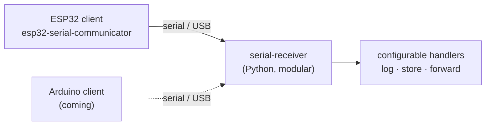
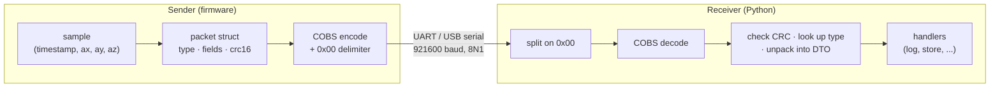
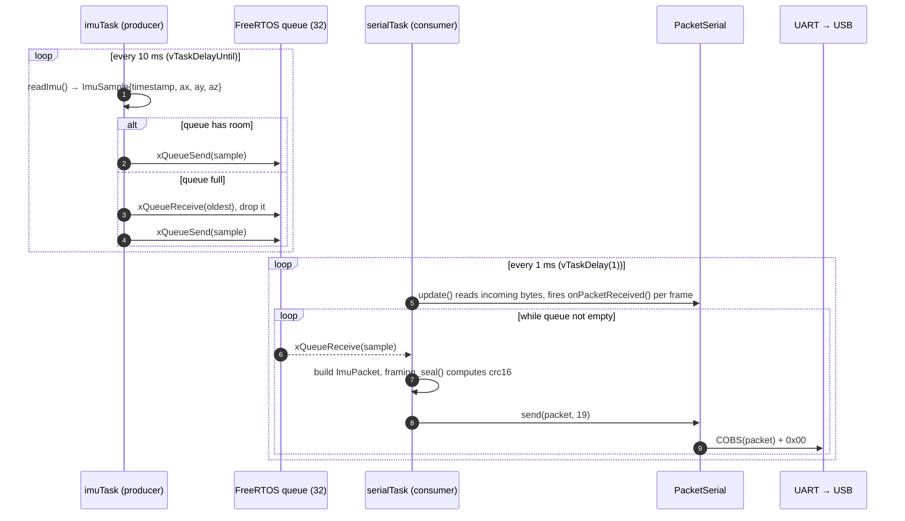
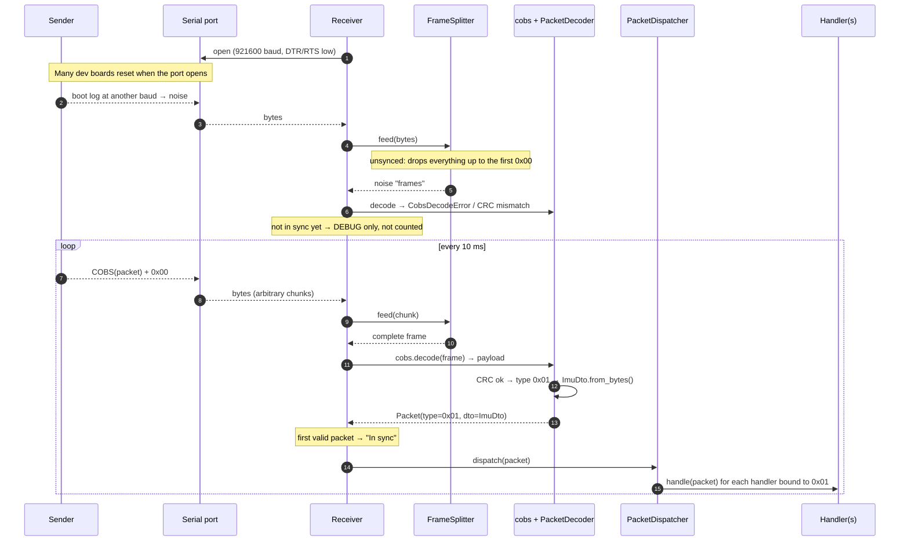
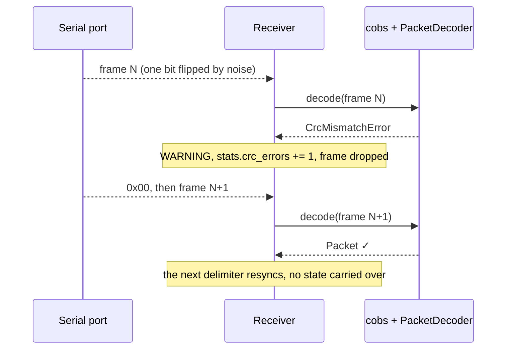

# IoT Embedded Serial Communication

A serial communication protocol for IoT embedded devices, with its implementations:

- **IoT embedded clients**: one subproject per platform. Each one is firmware that streams
  sensor and event data to a PC over a serial/USB link. **ESP32** is available today and
  **Arduino** (AVR) is coming next.
- **A modular receiver in Python** that reads that stream from any client. Which data
  structure each packet is decoded into, and what happens to it (logging, storage, …),
  are set in configuration, with no code changes.

All clients speak the **same protocol**, so the receiver works with any of them without
knowing which board is on the other end. The client **pushes** binary packets as soon as
they're ready. Each packet is protected by a **CRC-16** and framed with **COBS**, so `0x00`
only ever appears as the frame delimiter.



| Subproject | Role | Status |
|---|---|---|
| [`esp32-serial-communicator/`](esp32-serial-communicator/) | **IoT client for ESP32**: firmware for an ESP32-C3 (PlatformIO + Arduino framework + PacketSerial). Two FreeRTOS tasks (producer/consumer) stream simulated IMU samples at 100 Hz. | available |
| *Arduino client* | **IoT client for Arduino** (AVR: Uno, Nano, Mega): same protocol, single `loop()` without RTOS, lower baud rate. | coming |
| [`serial-receiver/`](serial-receiver/) | **Modular receiver**: Python app (uv). Reads a serial port, decodes and validates frames, deserializes each payload into a configurable DTO, and dispatches it to configurable handlers. Hardware-agnostic. | available |

This README describes the shared protocol, the reasoning behind it, the IMU example, and how
to add new packet types. Each subproject has its own README for build and usage details.

**Contents:**
[Quick start](#quick-start) ·
[Design choices](#design-choices) ·
[Architecture](#architecture) ·
[Protocol: packet, CRC-16, COBS](#protocol) ·
[Packet examples](#packet-examples) ·
[Data flow](#data-flow) ·
[Robustness](#robustness-what-happens-when-things-go-wrong) ·
[The IMU example](#the-imu-example) ·
[Extending to other examples](#extending-to-other-examples) ·
[Packet type registry](#packet-type-registry) ·
[Author and license](#author-and-license)

---

## Quick start

```bash
# 1. flash the sender (once, or after changing the firmware)
cd esp32-serial-communicator && pio run -t upload

# 2. find the port carrying decodable packets (optional)
cd ../serial-receiver && uv run serial-receiver --discover

# 3. receive: with no port configured, it uses the only port carrying decodable packets
uv run serial-receiver
```

```
15:40:44.608 INFO    serial_receiver.receiver.receiver: In sync: first valid packet received
15:40:44.608 INFO    serial_receiver.handlers.logging_packet_handler: IMU t=94ms ax=+0.146 ay=+0.478 az=+9.810 m/s^2
15:40:49.507 INFO    serial_receiver.receiver.receiver: Stats: 98.0 pkt/s | ok=490 errors=0 (0.00%: ...) overflows=0
```

A port can be held by only one process at a time: stop the receiver before flashing.

---

## Design choices

| Choice | Instead of | Why |
|---|---|---|
| **Push streaming**: the device sends whenever it has data | Request/response (e.g. Modbus RTU polling) | No polling round-trips. Latency is just the transmission time, and the PC never has to know when data is ready. |
| **Binary packed structs** | Text (CSV, JSON lines) | Compact (19 bytes per IMU sample vs ~50 as text), no parsing or float formatting on the MCU, fixed size per packet type. |
| **COBS framing** with a `0x00` delimiter | Length prefix, start byte + escaping, SLIP | Binary data can contain any byte, including `0x00`. COBS removes all zeros from the payload at a fixed cost of 1 byte per 254, so `0x00` reliably marks a frame boundary. After any corruption, the receiver resyncs at the next `0x00`. |
| **CRC-16/CCITT** on every packet | No check, or a simple sum | Catches corrupted bytes (all single- and double-bit errors and every burst up to 16 bits) for 2 bytes of overhead. A corrupted packet is discarded instead of producing wrong numbers. |
| **Type byte** first in every packet | One fixed packet layout | Several data sources share one link. The receiver picks the layout from the first byte. |
| **One task owns the serial port** (firmware) | Every task writes to `Serial` | `PacketSerial` isn't thread-safe. Producers hand data over through a FreeRTOS queue, so no mutex is needed and frames are never interleaved. |

---

## Architecture

**Push streaming.** The device sends a packet as soon as one is ready. There's no
request/response protocol (no polling as in Modbus RTU): the PC just listens.

**Message.** Each message is a small binary struct. It starts with a type byte, then carries
whatever fields the application needs, and ends with a 2-byte CRC. The IMU packet:

| Field | Type | Size |
|---|---|---|
| type | `uint8` | 1 byte |
| timestamp | `uint32` | 4 bytes |
| ax | `float32` | 4 bytes |
| ay | `float32` | 4 bytes |
| az | `float32` | 4 bytes |
| crc16 | `uint16` | 2 bytes |

**CRC.** A CRC-16/CCITT-FALSE is computed over the type byte and the fields, and appended.
The receiver recomputes it and discards the packet if it doesn't match
(details in [Layer 2](#layer-2-integrity-crc-16ccitt-false)).

**Framing.** Packet + CRC are COBS-encoded before sending, so the byte `0x00` never appears
except as the frame delimiter:

```
[ COBS-encoded(packet + CRC) ] [ 0x00 ]
```

The receiver reads bytes until it sees `0x00`, decodes the COBS frame, then verifies the CRC
(details in [Layer 3](#layer-3-framing-cobs--0x00)).

**Sender.** Two FreeRTOS tasks connected by a queue. A producer task reads the data, and a
serial task is the only one that touches the serial port. [PacketSerial](https://github.com/bakercp/PacketSerial)
handles COBS, the `0x00` delimiter and the packet-received callback.

**Receiver.** COBS and the CRC are plain Python, with no dependency besides `pyserial` for the
port. Which data structure each packet type is decoded into, and what happens to it, is set in
a config file.

### Building blocks

| Aspect | Choice | Why |
|---|---|---|
| Packet layout | `type` byte first, then packed fields, then `crc16` (IMU: 19 B) | Several data sources can share one link, and adding one doesn't change the format of the others. |
| CRC | **CRC-16/CCITT-FALSE** (poly `0x1021`, init `0xFFFF`) | "CRC-16/CCITT" covers several variants, so the exact one is named. |
| CRC coverage | type byte + fields (everything before the CRC) | The type byte is protected too: a corrupted type can't send a packet to the wrong DTO. |
| Framing | COBS + `0x00`: PacketSerial on the device, a validating decoder on the PC ([`cobs.py`](serial-receiver/src/serial_receiver/protocol/cobs.py)) | Malformed frames are rejected instead of decoded into garbage. |
| Byte order | little-endian, packed structs | Native on ESP32 (Xtensa and RISC-V) and on x86/ARM PCs: no byte swapping. |
| Baud rate | per client: 921600 on ESP32, 115200 on Arduino AVR (coming) | Each board uses the fastest rate its USB-UART bridge handles reliably (see [Physical link](#physical-link)). |
| Concurrency | producer task + serial task + queue. Both on core 0 on the single-core ESP32-C3 | See the [firmware README](esp32-serial-communicator/README.md#how-it-works). |
| Receiver | `serial-receiver` package: configurable DTOs and handlers, stats, discovery | See the [receiver README](serial-receiver/README.md). |

---

## Protocol

The protocol has three layers. Each layer only knows about the one directly below it:



| Layer | Adds | Detects | Implemented in |
|---|---|---|---|
| 1. Packet | type byte + fixed-layout fields | which data structure this is | `framing.h` structs ↔ `dto/` classes |
| 2. Integrity | 2-byte CRC-16 | corrupted bytes | `crc16_ccitt()` (C and Python) |
| 3. Framing | COBS (+1 byte) and a `0x00` delimiter | where each packet starts and ends | PacketSerial ↔ `FrameSplitter` + `cobs.py` |

### Layer 1: packet (payload)

Each packet is a **packed, little-endian** C struct. Its layout depends on the type byte:

| Offset | Size | Field | Notes |
|---:|---:|---|---|
| 0 | 1 | `type` | `uint8`. Selects the layout of the fields that follow (see the [registry](#packet-type-registry)). |
| 1 | N | fields | Fixed size and layout for each type. Little-endian: `uint32`, `float32` (IEEE 754), ... |
| 1+N | 2 | `crc16` | `uint16` LE. CRC-16/CCITT-FALSE over bytes `0 .. N`, i.e. type **and** fields. |

- **Packed** (`__attribute__((packed))`): no padding between fields, so the struct's bytes are
  exactly what goes on the wire. Without it, the compiler would insert 3 padding bytes after
  `type` to align the `uint32`. The receiver describes the same layout with a Python
  `struct` format such as `"<Ifff"` (`<` = little-endian, no padding).
- **Floats** are IEEE 754 single precision, the native format on both sides. They're sent as
  their 4 raw bytes, with no text conversion: `9.81` becomes `C3 F5 1C 41` and comes back as
  `9.8100004196…`, the nearest float32.
- **Both sides must match exactly.** The firmware defines the structs in
  [`lib/framing/framing.h`](esp32-serial-communicator/lib/framing/framing.h). The receiver
  mirrors each one as a DTO class in [`serial_receiver/dto/`](serial-receiver/src/serial_receiver/dto/),
  bound to its type byte in [`receiver.toml`](serial-receiver/receiver.toml).

### Layer 2: integrity (CRC-16/CCITT-FALSE)

**What a CRC is.** A Cyclic Redundancy Check treats the message as one long binary number
(a polynomial with coefficients 0/1). It divides that number by a fixed **generator
polynomial**, using arithmetic where addition is XOR and there are no carries. The
16-bit **remainder** is the CRC. The sender appends it. The receiver repeats the division
over the same bytes, and if even one bit changed, the remainder is almost certainly different.

**Parameters.** "CRC-16/CCITT" names a family of variants. This project uses the
**CCITT-FALSE** one:

| Parameter | Value | Meaning |
|---|---|---|
| Width | 16 bits | 2 bytes of overhead per packet |
| Polynomial | `0x1021` = x¹⁶ + x¹² + x⁵ + 1 | the generator (the x¹⁶ term is implicit) |
| Initial value | `0xFFFF` | register value before the first byte. Non-zero, so leading `0x00` bytes still change the CRC. |
| Reflect in / out | no / no | bits processed most-significant first |
| Final XOR | `0x0000` | the register is the CRC as is |
| Check value | `0x29B1` | CRC of the ASCII string `"123456789"`, used to verify an implementation (the Python tests do) |
| Covers | type + fields | every byte of the packet before the CRC |
| Stored as | `uint16` **little-endian** | the CRC `0x8022` goes on the wire as `22 80` |

**The algorithm**, the same on both sides
([C](esp32-serial-communicator/lib/framing/framing.cpp),
[Python](serial-receiver/src/serial_receiver/protocol/crc.py)):

```text
uint16_t crc = 0xFFFF;                              // initial value
for each byte b:
    crc ^= (uint16_t)b << 8;                        // bring the byte into the top half of the register
    repeat 8 times:                                 // one step per bit, most significant first
        if (crc & 0x8000) crc = (crc << 1) ^ 0x1021;  // top bit 1: shift and "subtract" (XOR) the polynomial
        else              crc =  crc << 1;            // top bit 0: just shift
return crc;                                         // 16-bit remainder (kept to 16 bits)
```

**Step by step, for one byte (`0x01`).** Start from `0xFFFF`, XOR the byte into the top
half, then do 8 shift steps:

| Step | Top bit before | Action | Register (binary) | Hex |
|---:|:---:|---|---|---|
| start | | `0xFFFF ^ (0x01 << 8)` | `1111 1110 1111 1111` | `FEFF` |
| 1 | 1 | shift, XOR `1021` | `1110 1101 1101 1111` | `EDDF` |
| 2 | 1 | shift, XOR `1021` | `1100 1011 1001 1111` | `CB9F` |
| 3 | 1 | shift, XOR `1021` | `1000 0111 0001 1111` | `871F` |
| 4 | 1 | shift, XOR `1021` | `0001 1110 0001 1111` | `1E1F` |
| 5 | 0 | shift | `0011 1100 0011 1110` | `3C3E` |
| 6 | 0 | shift | `0111 1000 0111 1100` | `787C` |
| 7 | 0 | shift | `1111 0000 1111 1000` | `F0F8` |
| 8 | 1 | shift, XOR `1021` | `1111 0001 1101 0001` | `F1D1` |

So `CRC(01) = 0xF1D1`, and that value is the starting register for the next byte.

**Over a whole packet.** For the IMU packet of the [first example](#1-imu-sample-typical-values),
the register after each byte is:

| Byte # | 0 | 1 | 2 | 3 | 4 | 5 | 6 | 7 | 8 | 9 | 10 | 11 | 12 | 13 | 14 | 15 | 16 |
|---|---|---|---|---|---|---|---|---|---|---|---|---|---|---|---|---|---|
| Byte | `01` | `E8` | `03` | `00` | `00` | `00` | `00` | `00` | `3F` | `00` | `00` | `80` | `BE` | `C3` | `F5` | `1C` | `41` |
| CRC after | `F1D1` | `5218` | `52D4` | `AEB7` | `E324` | `E94D` | `2107` | `3343` | `828C` | `3DCA` | `2DFE` | `9A47` | `23E6` | `1B2E` | `32E0` | `25AC` | **`8022`** |

The final `0x8022` is appended as `22 80`. Note how every `00` byte still changes the
register: zeros aren't ignored.

**What it catches.** For this polynomial and packets this short:

| Error | Detected |
|---|---|
| Any single flipped bit | always |
| Any two flipped bits | always (for messages up to 4,095 bytes) |
| Any odd number of flipped bits | always (the polynomial has x + 1 as a factor) |
| A burst of errors no longer than 16 bits | always |
| Anything else (longer bursts, random garbage) | all but about 1 in 65,536 |

What a CRC **doesn't** catch is a packet that's lost entirely, because the next frame is
simply valid. That's what a sequence number would add (see [ideas](#ideas-for-later)).

**Why it matters, concretely.** Flip a single bit in the IMU packet above, bit 0 of byte 8
(`3F` → `3E`): `ax` silently changes from `0.5` to `0.125`. That's a plausible value, so no
range check would notice. The CRC recomputed over the damaged bytes is `0x6B01`, not the
stored `0x8022`, and the packet is dropped (see the [corrupted packet example](#5-a-corrupted-packet)).

### Layer 3: framing (COBS + `0x00`)

**The problem.** The receiver gets a continuous stream of bytes and has to find where each
packet starts and ends. Binary packets can contain **any** byte value, `0x00` included (the
IMU example has seven of them), so no byte value can be reserved as a marker unless it's
first removed from the data.

**The solution.** COBS (Consistent Overhead Byte Stuffing) rewrites the packet so that it
contains **no `0x00` at all**, which frees `0x00` to be used as the frame delimiter:

```
wire:  [ COBS( type | fields | crc16 ) ] [ 0x00 ]
```

**Encoding.** Cut the data at every `0x00`. Write each piece as a **code byte**
(piece length + 1) followed by the piece, and drop the zero itself: the code byte implies
it. A piece of 254 non-zero bytes gets the code `0xFF`, which means "254 bytes, no zero
after them". Long zero-free runs are split this way.

```
data:     11 22 00 33
pieces:   [11 22] 00 [33]
encoded:  03 11 22  02 33          03 = 2 bytes follow, then a zero; 02 = 1 byte follows (end)
wire:     03 11 22 02 33 00
```

**Decoding** reverses it, with a pointer walking the frame:

1. Read a code byte `c`.
2. Copy the next `c - 1` bytes to the output.
3. If `c < 0xFF` and the frame isn't finished, output a `0x00`.
4. Repeat until the end of the frame.

**Edge cases** (real output of [`cobs.py`](serial-receiver/src/serial_receiver/protocol/cobs.py)):

| Data | Encoded | Notes |
|---|---|---|
| (empty) | `01` | one empty piece |
| `00` | `01 01` | two empty pieces with a zero between them |
| `00 00` | `01 01 01` | |
| `11 00` | `02 11 01` | a trailing zero becomes an empty final piece |
| `11 22 33` | `04 11 22 33` | no zeros: just one code byte in front |
| `11 22 00 33` | `03 11 22 02 33` | |
| `01 02 … FE` (254 non-zero bytes) | `FF 01 … FE 01` | a full block (`FF`), then an empty final piece |
| `01 02 … FF` (255 non-zero bytes) | `FF 01 … FE 02 FF` | a full block, then a 1-byte piece |

The encoder in PacketSerial (`Encoding/COBS.h`) produces exactly the same bytes, edge cases
included, so frames built on either side are identical.

**Properties.**

- **Fixed, tiny overhead.** A packet of up to 253 bytes always grows by exactly **1 byte**,
  whatever its content. With "escape" schemes like SLIP, a packet full of special bytes can
  double in size. IMU: 19 bytes → 20 COBS + 1 delimiter = 21 on the wire.
- **Instant resync.** A `0x00` on the wire is *always* a frame boundary. If bytes are lost
  or corrupted, the damage stays inside one frame, and the receiver starts clean at the next
  `0x00`. No length field can be misread and throw it off for several packets.
- **Validation for free.** In a valid frame, every code byte points to another code byte or
  exactly to the end. A code pointing past the end, or a `0x00` inside the frame, means
  corruption. [`cobs.decode()`](serial-receiver/src/serial_receiver/protocol/cobs.py) raises
  `CobsDecodeError` instead of returning garbage. Noise read at the wrong baud rate (e.g.
  `80 80 F8 88`: "block at offset 0 claims 127 bytes, only 3 left") is rejected this way,
  before the CRC is even computed.

On the device, PacketSerial does the encoding and appends the delimiter
(`packetSerial.send()`). On the PC, [`FrameSplitter`](serial-receiver/src/serial_receiver/protocol/frame_splitter.py)
splits the stream on `0x00` and `cobs.decode()` decodes each frame.

### Physical link

| Parameter | Value |
|---|---|
| Baud rate | Set per client, and the receiver's `baud` in [`receiver.toml`](serial-receiver/receiver.toml) must match it. ESP32: 921600 (`SERIAL_BAUD` in [`app_config.h`](esp32-serial-communicator/include/app_config.h)). Arduino AVR (coming): 115200, the reliable ceiling for its USB bridges. |
| Format | 8N1 (10 bits on the line per byte) |
| Direction | device → PC today. PC → device uses the same format (planned, see [commands](#c-pc--device-commands)). |

**Throughput budget**: an IMU frame is 21 bytes, i.e. 210 bits on the line. At 921600 baud
that's about **4,400 frames/s** maximum. At 100 Hz the link is about 2.3% busy, so there's
plenty of room for more sources or a higher rate.

---

## Packet examples

All the bytes below are real, computed with the receiver's own code (`struct.pack`,
`crc16_ccitt`, `cobs.encode`). Examples 3 and 4 use packet types that are
[proposed](#extending-to-other-examples) but not implemented yet.

### 1. IMU sample, typical values

Sample: `timestamp = 1000 ms`, `ax = 0.5`, `ay = -0.25`, `az = 9.81` m/s².

**Packet (19 bytes)**

| Offset | Field | Type | Value | Bytes (LE) |
|---:|---|---|---|---|
| 0 | type | `uint8` | `0x01` (IMU) | `01` |
| 1 | timestamp | `uint32` | 1000 | `E8 03 00 00` |
| 5 | ax | `float32` | 0.5 | `00 00 00 3F` |
| 9 | ay | `float32` | -0.25 | `00 00 80 BE` |
| 13 | az | `float32` | 9.81 (stored as 9.8100004196…) | `C3 F5 1C 41` |
| 17 | crc16 | `uint16` | `0x8022` = CRC over bytes 0..16 ([trace](#layer-2-integrity-crc-16ccitt-false)) | `22 80` |

```
payload: 01 E8 03 00 00 00 00 00 3F 00 00 80 BE C3 F5 1C 41 22 80
```

**COBS (20 bytes).** The payload contains seven `0x00` bytes, so it splits into eight pieces:

| Code | Piece copied | Then |
|---|---|---|
| `04` | `01 E8 03` | zero |
| `01` | (empty) | zero |
| `01` | (empty) | zero |
| `01` | (empty) | zero |
| `01` | (empty) | zero |
| `02` | `3F` | zero |
| `01` | (empty) | zero |
| `09` | `80 BE C3 F5 1C 41 22 80` | end of frame, no zero |

**On the wire (21 bytes)**

```
04 01 E8 03 01 01 01 01 02 3F 01 09 80 BE C3 F5 1C 41 22 80 00
└──────────────────────── COBS frame ─────────────────────┘ └ delimiter
```

The receiver reverses the steps: split on `00` → COBS decode → CRC over the first 17 bytes
must equal `0x8022` → type `0x01` → `ImuDto` → unpack the 16 field bytes with `"<Ifff"`.

### 2. IMU sample right after boot (lots of zeros)

The first simulated sample: `timestamp = 0`, `ax = 0.0`, `ay = 0.5`, `az = 9.81`. Eleven of its
19 bytes are `0x00`, which makes it a worst case for zeros. The COBS output is still exactly
1 byte longer:

| | Bytes | Size |
|---|---|---:|
| payload | `01` · `00 00 00 00` · `00 00 00 00` · `00 00 00 3F` · `C3 F5 1C 41` · `38 80` | 19 |
| CRC | `0x8038` → `38 80` | |
| COBS | `02 01` `01 01 01 01 01 01 01 01 01 01` `08 3F C3 F5 1C 41 38 80` | 20 |
| wire | `02 01 01 01 01 01 01 01 01 01 01 01 08 3F C3 F5 1C 41 38 80 00` | 21 |

`02 01` = the byte `01` and then a zero. Ten `01` codes = ten more zeros. `08` = the last 7 bytes.

### 3. Environment sample (proposed type `0x02`)

`timestamp = 60000 ms`, `temperature = 23.5 °C`, `humidity = 41.0 %RH`. Layout `"<Iff"`, 15-byte packet:

| Offset | Field | Type | Value | Bytes (LE) |
|---:|---|---|---|---|
| 0 | type | `uint8` | `0x02` (ENV) | `02` |
| 1 | timestamp | `uint32` | 60000 | `60 EA 00 00` |
| 5 | temperature | `float32` | 23.5 | `00 00 BC 41` |
| 9 | humidity | `float32` | 41.0 | `00 00 24 42` |
| 13 | crc16 | `uint16` | `0x9DC0` | `C0 9D` |

```
payload: 02 60 EA 00 00 00 00 BC 41 00 00 24 42 C0 9D             (15 B)
wire:    04 02 60 EA 01 01 01 03 BC 41 01 05 24 42 C0 9D 00        (17 B)
```

Decoding the frame, step by step:

| Code | Copy | Output so far |
|---|---|---|
| `04` | `02 60 EA` + zero | `02 60 EA 00` |
| `01` | zero | `… 00` |
| `01` | zero | `… 00` |
| `01` | zero | `… 00` |
| `03` | `BC 41` + zero | `… BC 41 00` |
| `01` | zero | `… 00` |
| `05` | `24 42 C0 9D` (end) | `02 60 EA 00 00 00 00 BC 41 00 00 24 42 C0 9D` ✓ |

### 4. Button event (proposed type `0x03`)

BOOT button (GPIO 9) pressed at `timestamp = 123456 ms`. Layout `"<IBB"`, 9-byte packet:

| Offset | Field | Type | Value | Bytes (LE) |
|---:|---|---|---|---|
| 0 | type | `uint8` | `0x03` (EVENT) | `03` |
| 1 | timestamp | `uint32` | 123456 | `40 E2 01 00` |
| 5 | pin | `uint8` | 9 | `09` |
| 6 | state | `uint8` | 1 (pressed) | `01` |
| 7 | crc16 | `uint16` | `0xE0DE` | `DE E0` |

```
payload: 03 40 E2 01 00 09 01 DE E0            (9 B)
wire:    05 03 40 E2 01 05 09 01 DE E0 00      (11 B)
```

### 5. A corrupted packet

Take the button event above and suppose noise turns the `pin` byte from `09` into `0B`
(one bit). The frame is still valid COBS, so it decodes. The CRC check is what catches it:

```
wire:     05 03 40 E2 01 05 0B 01 DE E0 00
decoded:  03 40 E2 01 00 0B 01 | DE E0
CRC over the first 7 bytes = 0x86BC  ≠  stored 0xE0DE  →  CrcMismatchError, packet dropped
```

Without the CRC, the receiver would report a press on GPIO 11, a button that was never touched.

### 6. A stream, as the receiver sees it

The receiver opens the port mid-stream. These bytes arrive, in arbitrary read chunks:

```
41 22 80 00 | 04 02 60 EA 01 01 01 03 BC 41 01 05 24 42 C0 9D 00 | 05 03 40 E2 01 05 0B 01 DE E0 00 | 02 01 01 01 01 01 01 01 01 01 01 01 08 3F C3 F5 1C 41 38 80 00
```

| Bytes | `FrameSplitter` | Decoding | Outcome |
|---|---|---|---|
| `41 22 80 00` | unsynced: dropped up to the first `00` | — | tail of a frame whose start was missed; not an error |
| `04 02 60 EA … C0 9D 00` | frame | COBS ok, CRC ok, type `0x02` | ENV packet → handlers (once `0x02` is configured) |
| `05 03 40 E2 … DE E0 00` | frame | COBS ok, **CRC mismatch** | dropped, `crc_errors += 1` (example 5) |
| `02 01 01 … 38 80 00` | frame | COBS ok, CRC ok, type `0x01` | IMU packet → handlers (example 2) |

The corrupted packet in the middle costs exactly one packet. The frames before and after it are untouched.

---

## Data flow

### Inside the sender (firmware)



Only `serialTask` ever touches `Serial`/`PacketSerial`. On the single-core ESP32-C3 both
tasks share core 0. `serialTask` has the higher priority (3 vs 2) for low output jitter.

### End to end, including startup and sync



### A corrupted byte



---

## Robustness: what happens when things go wrong

| Situation | Detected by | Outcome |
|---|---|---|
| Bit flipped inside a frame | CRC mismatch (or invalid COBS) | That packet is discarded and counted as an error. The next frame is unaffected. |
| Bytes lost mid-frame | COBS validation, CRC, or length check | Same as above. |
| Delimiter lost (two frames merged) | CRC or length check | One merged frame discarded (two packets lost). Resync at the next `0x00`. |
| Receiver joins mid-stream | `FrameSplitter` starts unsynced | The partial first frame is dropped silently, not counted as an error. |
| Device resets on port open (boot log) | Sync phase in `Receiver` | Garbage before the first valid packet is logged at DEBUG only and kept out of the stats. |
| Runaway frame (noise, wrong baud) | `FrameSplitter` max length (256 B) | Discarded up to the next `0x00`, counted as an `overflow`. |
| Valid packet of a type with no DTO | `PacketDecoder` | `UnknownPacketTypeError`, counted as `unknown_type`. The sender is newer than the receiver's config. |
| Producer faster than the serial link | Firmware queue full | The **oldest** sample is dropped, so the sampling rate stays steady. Not visible on the wire (see [ideas](#ideas-for-later)). |
| Device unplugged or reflashed | `SerialException` | The receiver logs it and reopens the port every 2 s. |

The receiver logs `Stats:` every 5 s. Before raising the sample rate or adding sources,
check that the CRC error rate stays near zero: a rate that keeps rising usually means the link is unreliable: baud rate too high, or a bad
cable or hub.

---

## The IMU example

The baseline case: one periodic numeric payload, pushed continuously, using the FreeRTOS
producer/consumer pattern.

**What it streams**: one accelerometer sample every 10 ms (100 Hz). No physical IMU is
connected yet, so `readImu()` in [`main.cpp`](esp32-serial-communicator/src/main.cpp)
**simulates** one:

| Field | Value | Purpose |
|---|---|---|
| `timestamp` | `millis()` when the sample is taken (real) | Lets the receiver measure rate and jitter, and spot gaps. |
| `ax` | `0.5 · sin(2π · 0.5 Hz · t)` | A slow, visible sway: each packet differs from the last. |
| `ay` | `0.5 · cos(2π · 0.5 Hz · t)` | Same sway, 90° out of phase. |
| `az` | `9.81` (constant) | Gravity, as if the board were lying flat. |

**Where each piece lives**:

| Concern | Sender (firmware) | Receiver (Python) |
|---|---|---|
| Wire layout | `struct ImuPacket` in `lib/framing/framing.h` | `ImuDto` in `dto/imu_dto.py` (`LAYOUT = "<Ifff"`) |
| Type byte | `PACKET_TYPE_IMU = 0x01` | `type = 0x01` in `receiver.toml` |
| Producing / consuming | `imuTask` → queue → `serialTask` → `sendImuPacket()` | `Receiver` → `PacketDecoder` → `PacketDispatcher` |
| What happens to it | — | `LoggingPacketHandler` logs `ImuDto.__str__()` |
| Rate | `IMU_SAMPLE_PERIOD_MS` in `include/app_config.h` | measured in the `Stats:` line |

**Making it real**: wire an IMU (e.g. an MPU6050 over I2C) and replace the body of
`readImu()` with the driver read. Nothing else changes: protocol, tasks and receiver all stay as they are.

---

## Extending to other examples

The framing and CRC layers never change. Adding a data source means **one new packet
type**, defined on both sides. The general recipe:

1. **Pick a type byte** that isn't used yet (see the [registry](#packet-type-registry)).
2. **Firmware**: add the value to `PacketType` and a packed struct ending in
   `uint16_t crc` to `lib/framing/framing.h`. Add a `static_assert` on its size.
3. **Firmware**: produce it. Either a new producer task feeding the queue, or an event
   source. The serial task builds the struct, calls `framing_seal()` and sends it.
4. **Receiver**: a new file in `serial_receiver/dto/` with a `PacketDto` dataclass
   whose `LAYOUT` matches the struct's fields (type byte and CRC excluded).
5. **Receiver**: a `[[packets]]` block in `receiver.toml` binding the type byte to the DTO and to its handlers.
6. **Never change an existing layout in place.** If a layout must change, give it a new
   type byte. An old receiver then reports `unknown_type` instead of decoding garbage.

### A. Several sensors on one link: environment sensor

**Firmware.** Add a struct in `framing.h`:

```c
enum PacketType : uint8_t {
    PACKET_TYPE_IMU = 0x01,
    PACKET_TYPE_ENV = 0x02,
};

struct EnvPacket {
    uint8_t type;        // PACKET_TYPE_ENV
    uint32_t timestamp;  // ms since boot
    float temperature;   // °C
    float humidity;      // %RH
    uint16_t crc;
} __attribute__((packed));
static_assert(sizeof(EnvPacket) == 15, "EnvPacket layout must match the receiver");
```

With more than one producer, the queue carries a **tagged item**: a type byte plus a
union, so it's large enough for any sample. Each producer task fills its own member:

```c
struct QueueItem {
    PacketType type;
    union { ImuSample imu; EnvSample env; };
};
```

`serialTask` switches on `item.type` to build the matching packet. The ESP32-C3 also has
an internal temperature sensor (`temperatureRead()`), which can feed this without extra hardware.

**Receiver.** Add `dto/env_dto.py`:

```python
@dataclass(frozen=True, slots=True)
class EnvDto(PacketDto):
    LAYOUT: ClassVar[struct.Struct] = struct.Struct("<Iff")  # timestamp, temperature, humidity

    timestamp_ms: int
    temperature: float
    humidity: float

    def __str__(self) -> str:
        return f"ENV t={self.timestamp_ms}ms {self.temperature:.1f}°C {self.humidity:.0f}%RH"
```

and bind it in `receiver.toml`:

```toml
[[packets]]
type = 0x02
dto = "serial_receiver.dto.env_dto:EnvDto"
handlers = ["serial_receiver.handlers.logging_packet_handler:LoggingPacketHandler"]
```

### B. Sparse events: BOOT button

Packets don't have to be periodic. An event packet is sent **only when something
changes**, e.g. the board's BOOT button on GPIO9:

| Field | Type | Meaning |
|---|---|---|
| type | `uint8` | `0x03` |
| timestamp | `uint32` | ms since boot when the change was detected |
| pin | `uint8` | GPIO number |
| state | `uint8` | 1 = pressed, 0 = released |
| crc16 | `uint16` | |

On the firmware side, a small task polls and debounces the pin, and enqueues an item only on
a state change. On the receiver side the DTO's layout is `"<IBB"`. Because the receiver
dispatches by type, a dedicated handler (say, one that triggers an action on press) can be
bound to `0x03` alone. The IMU stream keeps going to its own handlers.

### C. PC → device commands

The reverse direction uses **exactly the same format**: type byte, fields, CRC-16, COBS,
`0x00`. Command types can share the type space, e.g. `0x80`–`0xFF` for commands.

- **Firmware**: `onPacketReceived()` in `main.cpp` is already wired to `PacketSerial`. It
  runs inside `serialTask`, so it can safely reply. It needs to check the size against the
  expected struct, verify the CRC, and switch on the command type.
- **Receiver**: the building blocks for sending already exist. `PacketDecoder.encode(Packet)`
  produces a payload with its CRC, and `cobs.encode()` frames it. What's missing is a
  write path: a small sender that serializes a command DTO with them, writes it to the
  open port, and appends `0x00`.

### Ideas for later

- **Status/heartbeat packet** carrying firmware counters, such as samples dropped on queue
  overflow, so data loss on the device side becomes visible to the receiver.
- **Sequence number** in each packet, so the receiver can count packets lost on the link,
  not only corrupted ones.

---

## Packet type registry

Keep this table, `framing.h` and `receiver.toml` in sync.

| Type | Name | Direction | Fields after the type byte | Packet size | Status |
|---|---|---|---|---:|---|
| `0x01` | IMU | device → PC | `timestamp: u32` (ms since boot), `ax, ay, az: f32` (m/s²) | 19 B | implemented (simulated data) |
| `0x02` | ENV | device → PC | `timestamp: u32`, `temperature: f32` (°C), `humidity: f32` (%RH) | 15 B | example above, not implemented |
| `0x03` | EVENT | device → PC | `timestamp: u32`, `pin: u8`, `state: u8` | 9 B | example above, not implemented |

---

## Author and license

**Author:** Marco Picone ([picone.m@gmail.com](mailto:picone.m@gmail.com))

Released under the [MIT License](LICENSE), a fully open-source license: you can use, copy,
modify, merge, publish, distribute, sublicense and sell copies of the software, as long as
the copyright and license notice are kept. The license covers every subproject in this repository.
