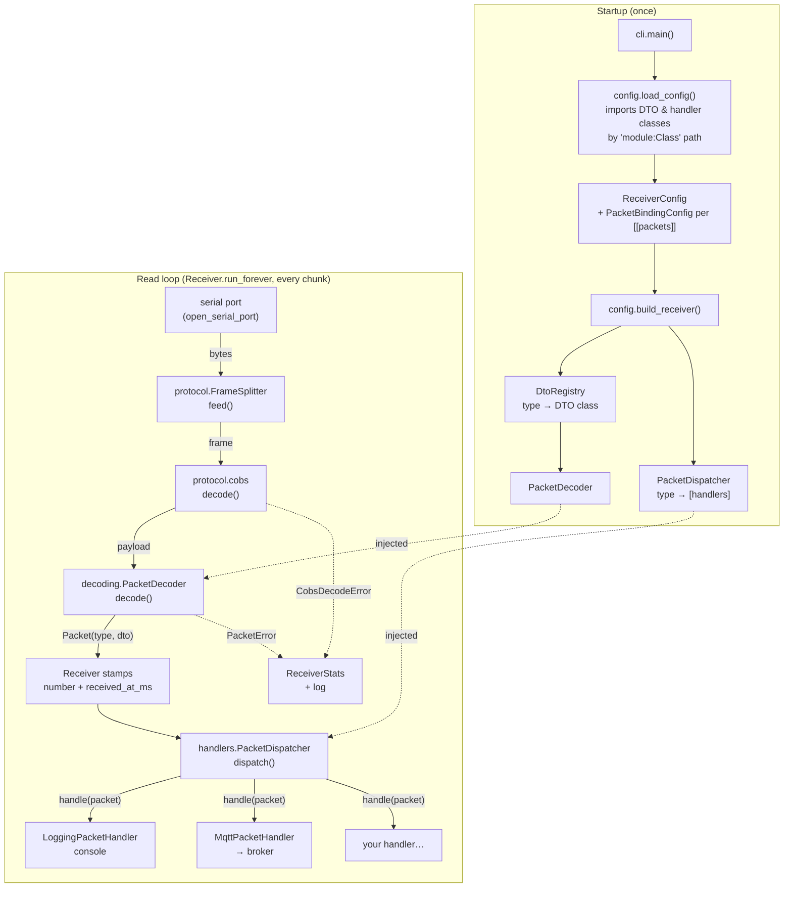
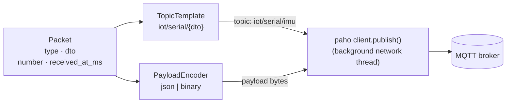

# serial-receiver

Reads a binary stream from a serial port, splits it into frames on `0x00`,
COBS-decodes them, verifies the CRC-16, deserializes each payload into the **DTO**
configured for its packet type, and passes it to the configured **handlers**.
Two handlers are built in: one **logs** each packet to the console, the other
**publishes** it to an **MQTT broker** as JSON or binary. You can add your own.

It works with any sender that speaks the protocol and isn't tied to any particular
hardware. The protocol itself (packet format, CRC, COBS, byte-level example, sequence
diagrams) is documented in the [root README](../README.md#protocol).

**Contents:**
[Run](#run) ·
[Architecture](#architecture) ·
[Configuration](#configuration-which-dto-which-handlers) ·
[Built-in handlers](#built-in-handlers) ·
[MQTT handler](#mqtt-handler) ·
[Adding a packet type](#adding-a-packet-type) ·
[Writing a handler](#writing-a-handler) ·
[Device discovery](#device-discovery) ·
[Logs and statistics](#logs-and-statistics) ·
[Layout](#layout) ·
[Tests](#tests)

## Run

```bash
uv run serial-receiver                       # uses ./receiver.toml; no port set -> finds the one carrying decodable packets
uv run serial-receiver -c other.toml         # a different config
uv run serial-receiver -p /dev/ttyUSB0 -b 921600 --stats-interval 0   # CLI overrides the config
uv run serial-receiver --discover            # which serial ports carry decodable packets
uv run serial-receiver --log-level DEBUG     # also shows the garbage discarded while syncing
```

| Option | Default | Meaning |
|---|---|---|
| `-c, --config` | `./receiver.toml` | Config file: serial settings and packet type → DTO/handlers bindings. |
| `-p, --port` | `[serial] port`, else discovery | Serial port to read. |
| `-b, --baud` | `[serial] baud` (921600) | Must match the sender. |
| `--stats-interval` | `[stats] interval_s` (5) | Seconds between `Stats:` lines; `0` = off. |
| `--log-level` | `INFO` | `DEBUG` also shows frames discarded while syncing. |
| `--discover` | | Probe every port, print a report, exit. |
| `--probe-seconds` | 3 | Listening time per port, for `--discover` and for port auto-detection. `0` = `--discover` only lists ports. |

A setting given on the command line wins over `receiver.toml`, which wins over the built-in default.

### Several devices

One instance reads **one** serial port. For several devices, run one instance per port:

```bash
uv run serial-receiver -p /dev/cu.usbserial-A                     # terminal 1, e.g. an ESP32 at 921600
uv run serial-receiver -p /dev/cu.usbserial-B -c arduino.toml     # terminal 2, e.g. an Arduino at 115200
```

- Always set the port (`-p` or `[serial] port`). Without it, discovery finds several
  ports with decodable packets and stops with an error, instead of guessing.
- Use a separate config (`-c`) when devices differ in baud rate or packet types.
- Instances share nothing: statistics, reconnection and handlers are per instance.
  Handlers that write to files should get a different file per instance (via `options`),
  or lines from different processes may interleave.
- Log lines don't name the device. Which device a line comes from is only known from
  the instance (terminal) that printed it.

## Architecture

The code is split into packages by topic, with one class per file. The first
docstring of [`serial_receiver/__init__.py`](src/serial_receiver/__init__.py)
gives the same overview.



### Who calls whom

1. **Startup.** `cli.main()` parses the arguments and calls `load_config()`. The loader
   reads `receiver.toml`. For each `[[packets]]` block it imports the DTO class from its
   `"package.module:Class"` path, validates it, and resolves the block's handlers: a
   named handler (`[handlers.<name>]`) is instantiated once, on first use, and shared
   with every other block that lists it, while a class path creates a new instance.
   Handlers get their `options` as constructor arguments. The result is a frozen `ReceiverConfig`.
   `build_receiver()` then splits each binding in two:
   - type → DTO class goes into a `DtoRegistry`, wrapped by a `PacketDecoder`;
   - type → handlers goes into a `PacketDispatcher`.

   Both are **injected** into the `Receiver`, which therefore knows no packet type itself.
2. **Port.** `--port`, else `[serial] port`, else discovery: `find_protocol_device()`
   probes every port with the same decoder and takes the only one that decodes.
3. **Read loop.** `Receiver.run_forever()` opens the port and calls `_read_loop()`. The
   loop reads whatever bytes are available, and `FrameSplitter.feed()` turns them into
   complete frames (it keeps partial frames between reads). For each frame,
   `_handle_frame()` runs `cobs.decode()` and then `PacketDecoder.decode()`. The decoder
   checks the CRC, looks up the type byte in the registry, checks the size and calls
   `Dto.from_bytes()`. The result is a `Packet(packet_type, dto)`.
4. **Receive metadata.** Before dispatching, the receiver stamps the packet with
   `number`, a per-type sequence number from a `PacketCounter`, and `received_at_ms`, the
   wall-clock receive time. Every handler gets both, e.g. for the MQTT payload.
5. **Callbacks.** `PacketDispatcher.dispatch(packet)` calls `handle(packet)` on every
   handler bound to that type, **synchronously, on the read thread**, in config order.
   A handler that raises is logged and skipped. It never stops the stream or the
   other handlers.
6. **Failures.** Any step can reject a frame: `CobsDecodeError`, or a `PacketError`
   subclass (CRC mismatch, unknown type, wrong length). `_on_discard()` counts it in
   `ReceiverStats` and logs it. Before the first valid packet, rejected frames are
   expected noise: they're logged at DEBUG and counted separately (see [sync](#logs-and-statistics)).
7. **Errors on the port** (device unplugged or reset): `SerialException` is caught by
   `run_forever()`, which waits 2 s and reopens the port. The new connection starts
   unsynced again.
8. **Shutdown.** On exit (Ctrl+C), the CLI calls `Receiver.close()` →
   `PacketDispatcher.close()`, which calls `close()` once on every distinct handler, so the
   MQTT handler can disconnect from its broker.

### Threads

The receiver is **single-threaded**: reading, decoding and every `handle()` call run on
the main thread. A slow handler (network, disk) therefore delays reading, so slow work
belongs in a thread of the handler's own. That's what the MQTT handler does: paho's network
loop runs in a background thread, and `handle()` only queues the message.

Discovery also uses threads: `_probe_all()` runs one daemon thread per port, with a shared
deadline, so a port that hangs can't block it.

### Extension points

| To change… | Touch | No changes needed in |
|---|---|---|
| what a packet type is decoded into | a DTO in `dto/` + `receiver.toml` | decoder, receiver |
| what happens to decoded packets | a `PacketHandler` + `receiver.toml` | everything else |
| which packet types are accepted | `[[packets]]` blocks in `receiver.toml` | code |
| how a packet is turned into bytes for publishing | a `PayloadEncoder` in `serialization/` | handlers that use it |
| the wire format (COBS, CRC) | `protocol/` (and the sender) | DTOs, handlers |

## Configuration: which DTO, which handlers

`receiver.toml` binds each packet type byte to a DTO (what the payload is deserialized
into) and to a list of handlers (what happens to it). Classes are referenced as
`"package.module:Class"` and imported at startup, so they can also live outside this package:

```toml
[serial]
# port = "/dev/ttyUSB0"      # omit to use the only port carrying decodable packets
baud = 921600                # must match the sender's baud rate

[stats]
interval_s = 5.0             # 0 disables the periodic stats line

# Named handlers: created once, shared by every [[packets]] block that lists them.
[handlers.log]
class = "serial_receiver.handlers.logging_packet_handler:LoggingPacketHandler"
[handlers.log.options]
level = "INFO"

[handlers.mqtt]
class = "serial_receiver.handlers.mqtt.mqtt_packet_handler:MqttPacketHandler"
[handlers.mqtt.options]
client_id   = "serial-receiver-1"
broker_host = "localhost"
topic       = "iot/serial/{dto}"

[[packets]]
type = 0x01                  # the packet's first byte, as sent by the sender
dto = "serial_receiver.dto.imu_dto:ImuDto"
handlers = ["log", "mqtt"]
```

Each entry in a block's `handlers` list is one of:

| Entry | Means |
|---|---|
| `"log"` (a bare name) | The `[handlers.log]` instance. It's **created once, on first use, and shared** by every block that lists it. That matters for handlers holding a connection: one MQTT client for all packet types, instead of one per type fighting over the same client id. |
| `"pkg.mod:Class"` | A new instance, without options, for this block only. |
| `{ class = "pkg.mod:Class", options = {...} }` | A new instance with options, for this block only. |

- `options` are passed to the constructor as keyword arguments.
- Names can't contain `:`, so a name and a class path are never ambiguous.
- A named handler that no block uses isn't created at all (a warning says so), so a
  configured but unused MQTT handler never connects to its broker.
- `handlers = []` still decodes and validates the packet (it counts in the stats), but does nothing with it.
- The same DTO can be bound to several types, e.g. two identical sensors.
- Everything is validated **at startup**, with the block or handler name in the message:
  wrong path, a class that isn't a `PacketDto`/`PacketHandler`, a DTO whose `LAYOUT`
  disagrees with its fields, bad handler options, an unknown handler name, a duplicate
  type, a type outside `0x00`–`0xFF`.

The same wiring can be done in code, without a config file:

```python
registry = DtoRegistry()
registry.register(0x01, ImuDto)
dispatcher = PacketDispatcher()
dispatcher.register(0x01, LoggingPacketHandler())
receiver = Receiver("/dev/ttyUSB0", 921600, PacketDecoder(registry), dispatcher)
try:
    receiver.run_forever()
finally:
    receiver.close()   # handlers release their resources (e.g. the MQTT connection)
```

## Built-in handlers

| Handler | Class | What it does | Options |
|---|---|---|---|
| **Logging** | `serial_receiver.handlers.logging_packet_handler:LoggingPacketHandler` | Logs each packet's DTO (its `__str__`) to the console. | `level`: log level name or number (default `"INFO"`) |
| **MQTT** | `serial_receiver.handlers.mqtt.mqtt_packet_handler:MqttPacketHandler` | Publishes each packet to an MQTT broker, as JSON or binary. | see [MQTT handler](#mqtt-handler) |

Both work with any packet type, with no per-type code. The logging handler prints whatever
the DTO's `__str__` returns, and the MQTT handler builds topic and payload from the packet
and its DTO. For anything else (a CSV file, a database, an HTTP API), see
[Writing a handler](#writing-a-handler).

## MQTT handler

`MqttPacketHandler` publishes every packet it receives to an MQTT broker. It's built on
[paho-mqtt](https://pypi.org/project/paho-mqtt/) 2.x.



For each packet, the handler renders the **topic** from a template, encodes the
**payload** in the configured format, and hands both to paho, which sends them from its own
thread.

### Quick start

1. Run a broker, e.g. Mosquitto: `brew install mosquitto` (macOS), then `mosquitto -v`.
2. In `receiver.toml`, uncomment the `[handlers.mqtt]` block (it ships commented out,
   so the receiver runs without a broker) and add `"mqtt"` to the packet types to publish:

   ```toml
   [handlers.mqtt]
   class = "serial_receiver.handlers.mqtt.mqtt_packet_handler:MqttPacketHandler"
   [handlers.mqtt.options]
   client_id   = "serial-receiver-1"
   broker_host = "localhost"
   broker_port = 1883
   topic       = "iot/serial/{dto}"
   format      = "json"
   qos         = 0

   [[packets]]
   type = 0x01
   dto = "serial_receiver.dto.imu_dto:ImuDto"
   handlers = ["log", "mqtt"]
   ```

3. Start the receiver (`uv run serial-receiver -p <port>`) and watch the messages:

   ```bash
   mosquitto_sub -h localhost -t 'iot/#' -v
   ```

   ```
   iot/serial/imu {"packet_number":1,"received_timestamp":1791042044702,"packet_type":1,"dto":"ImuDto","data":{"timestamp_ms":94,"ax":0.1455181,"ay":0.478356,"az":9.81}}
   iot/serial/imu {"packet_number":2,"received_timestamp":1791042044712,"packet_type":1,"dto":"ImuDto","data":{"timestamp_ms":104,"ax":0.1604718,"ay":0.4735492,"az":9.81}}
   ```

Define the handler **once**, as a named handler, and list it in every packet type to
publish. All types then share one client and one connection. Two instances with the same
`client_id` would keep disconnecting each other.

### Options

| Option | Default | Meaning |
|---|---|---|
| `client_id` | *required* | MQTT client identifier. Must be **unique per broker connection**, so use one per receiver instance. |
| `broker_host` | *required* | Broker host name or IP. |
| `broker_port` | `1883` | Broker port. |
| `topic` | *required* | Destination topic, a template (see [Topic](#topic)). |
| `format` | `"json"` | `"json"` or `"binary"` (see [Payload](#payload)). |
| `qos` | `0` | `0` at most once, `1` at least once, `2` exactly once. |
| `retain` | `false` | Ask the broker to retain the last message on each topic. |
| `keepalive_s` | `60` | MQTT keepalive interval, in seconds. |
| `username` | none | Username, if the broker requires authentication. |
| `password_env` | none | Name of the **environment variable** holding the password, so it stays out of the config file. Requires `username`. |
| `max_queued_messages` | `1000` | QoS 1/2 messages kept in memory while disconnected (`0` = unlimited). |
| `float_digits` | `7` | JSON only: significant digits for floats (see [Payload](#payload)). |

All options are validated at startup. An unknown option, a bad value, an unset
`password_env` variable or a bad topic template is reported as a config error, before
anything connects.

### Topic

`topic` is a template with these placeholders:

| Placeholder | Becomes | Example |
|---|---|---|
| `{dto}` | the DTO class name, lowercased, without the `Dto` suffix | `ImuDto` → `imu` |
| `{packet_type}` | the type byte, two hex digits | `01` |
| `{client_id}` | the handler's client id | `serial-receiver-1` |

| Template | IMU packet (type `0x01`, `ImuDto`) goes to |
|---|---|
| `iot/serial/{dto}` | `iot/serial/imu` |
| `iot/{client_id}/{packet_type}` | `iot/serial-receiver-1/01` |
| `iot/esp32-a/{dto}` | `iot/esp32-a/imu` (the device named by hand) |
| `iot/serial/all` | `iot/serial/all` (every type on one topic: use the `dto` field to tell them apart) |

Unknown placeholders and the MQTT wildcards `+`/`#` are rejected at startup. With several
devices (one receiver instance each), give each instance its own `client_id` and put the
device in the topic, either by hand or with `{client_id}`.

### Payload

Every message carries the same information, in either format:

| Field | From | Meaning |
|---|---|---|
| `packet_number` | `Packet.number` | Sequence number **per packet type**, assigned by the receiver: the n-th IMU packet, the n-th ENV packet... It's not reset when the serial port reconnects, and a gap means packets of that type were lost after decoding. |
| `received_timestamp` | `Packet.received_at_ms` | When the receiver decoded it, in **ms since the Unix epoch** (PC clock). The device's own timestamp, if it has one, stays inside `data`. |
| `packet_type`, `dto` | `Packet` | What `data` is. |
| `data` | `Packet.dto` | The packet as received on the serial line. |

The two formats below encode the same IMU packet: `timestamp_ms = 1000`, `ax = 0.5`,
`ay = -0.25`, `az = 9.81`, received as the 42nd IMU packet at `1791042044608` ms. The bytes
are the real output of the encoders.

**`format = "json"`**: a compact UTF-8 JSON object (shown indented here):

```json
{
  "packet_number": 42,
  "received_timestamp": 1791042044608,
  "packet_type": 1,
  "dto": "ImuDto",
  "data": {"timestamp_ms": 1000, "ax": 0.5, "ay": -0.25, "az": 9.81}
}
```

- `data` comes from `PacketDto.to_dict()`, which returns every dataclass field under its
  own name by default. Override it in a DTO to rename fields, convert units or add derived
  values in the JSON, without touching the binary layout:

  ```python
  def to_dict(self) -> dict[str, object]:
      return {"t_ms": self.timestamp_ms, "accel_g": [self.ax / 9.81, self.ay / 9.81, self.az / 9.81]}
  ```

- Floats are rounded to `float_digits` significant digits. Packet fields are float32, and
  `9.81` read back as float32 is `9.8100004196167`. 7 digits is all float32 carries, so
  rounding restores `9.81`. Use a lower value (e.g. `4`) for shorter messages, or `17` to
  publish the exact float32 value.

**`format = "binary"`**: a fixed 12-byte header followed by the serial packet, 31 bytes for IMU:

| Offset | Size | Field | Encoding | Example bytes |
|---:|---:|---|---|---|
| 0 | 4 | `packet_number` | `uint32` LE, wraps after 2³²−1 | `2A 00 00 00` (42) |
| 4 | 8 | `received_timestamp` | `uint64` LE, ms since the Unix epoch | `C0 C2 6C 02 A1 01 00 00` |
| 12 | 19 | serial packet | type, fields and crc16, exactly as received, minus COBS (an MQTT message is already delimited) | `01 E8 03 00 00 00 00 00 3F 00 00 80 BE C3 F5 1C 41 22 80` |

The serial packet part is the same 19 bytes as in the root README's
[packet example](../README.md#1-imu-sample-typical-values), so the CRC still protects it end to end.

### Consuming the messages

A subscriber needs nothing from this project for JSON. For binary, it unpacks the header
and decodes the rest with the same layout, or reuses the receiver's own decoder. The
subscriber has to know which format a topic carries: the payload itself doesn't say
(a binary message can start with any byte, `{` included).

```python
import json, struct
import paho.mqtt.client as mqtt
from serial_receiver.decoding import DtoRegistry, PacketDecoder
from serial_receiver.dto.imu_dto import ImuDto

registry = DtoRegistry()
registry.register(0x01, ImuDto)
decoder = PacketDecoder(registry)

FORMAT = "json"   # must match the handler's `format`

def on_message(client, userdata, msg):
    if FORMAT == "json":
        envelope = json.loads(msg.payload)
        print(msg.topic, envelope["packet_number"], envelope["data"])
    else:
        number, received_ms = struct.unpack("<IQ", msg.payload[:12])
        packet = decoder.decode(msg.payload[12:])                  # verifies the CRC too
        print(msg.topic, number, received_ms, packet.dto)

client = mqtt.Client(mqtt.CallbackAPIVersion.VERSION2)
client.on_message = on_message
client.connect("localhost", 1883)
client.subscribe("iot/#")
client.loop_forever()
```

With `mosquitto_sub`, `-F '%t %l bytes: %x'` prints topic, length and hex of each binary message.

### Delivery and connection

- **Non-blocking.** paho's network loop runs in its own thread. `handle()` only queues
  the message (`publish()` is thread-safe), so a slow or absent broker never slows down
  serial reading.
- **Startup doesn't wait for the broker.** The connection is opened in the background, and
  paho reconnects on its own, waiting 1 to 30 s between attempts.
- **While disconnected** (verified against a real broker):

  | QoS | What happens to new messages |
  |---|---|
  | `0` | **Dropped.** They're counted, and a WARNING is logged at most every 10 s. |
  | `1`, `2` | **Queued** in memory and delivered after reconnecting, up to `max_queued_messages`. Beyond that, dropped and counted. |

  Use `qos = 1` if messages must survive a broker restart or a network outage. With
  `qos = 0`, data published during the outage is lost (it's still visible in the log).
- **Shutdown** (Ctrl+C): the receiver calls `close()` on its handlers, and the MQTT
  handler disconnects cleanly.

What the handler logs:

```
INFO    serial_receiver.handlers.mqtt.mqtt_packet_handler: MQTT serial-receiver-1 -> localhost:1883, topic 'iot/serial/{dto}', format json, qos 0
INFO    serial_receiver.handlers.mqtt.mqtt_packet_handler: MQTT serial-receiver-1: connected to localhost:1883
WARNING serial_receiver.handlers.mqtt.mqtt_packet_handler: MQTT serial-receiver-1: broker localhost:1883 unreachable, retrying in the background
WARNING serial_receiver.handlers.mqtt.mqtt_packet_handler: MQTT serial-receiver-1: 120 message(s) dropped (The client is not currently connected.)
INFO    serial_receiver.handlers.mqtt.mqtt_packet_handler: MQTT serial-receiver-1 closed: 4210 published, 120 dropped
```

## Adding a packet type

The sender side, and complete examples (environment sensor, button events, commands),
are in the root README's [Extending to other examples](../README.md#extending-to-other-examples).
On the receiver side:

1. **DTO**: a new file in `dto/` with one dataclass extending `PacketDto`. Its `LAYOUT`
   is the `struct` format of the fields between the type byte and the CRC, in the
   same order as the dataclass fields:

   ```python
   @dataclass(frozen=True, slots=True)
   class EnvDto(PacketDto):
       LAYOUT: ClassVar[struct.Struct] = struct.Struct("<Iff")

       timestamp_ms: int    # I  uint32
       temperature: float   # f  float32
       humidity: float      # f  float32

       def __str__(self) -> str:   # what LoggingPacketHandler prints
           return f"ENV t={self.timestamp_ms}ms {self.temperature:.1f}°C {self.humidity:.0f}%RH"
   ```

   Common format characters: `B`/`b` u8/i8, `H`/`h` u16/i16, `I`/`i` u32/i32, `f` float32, `d` float64.
   Always start with `<` (little-endian, no padding), to match a packed struct.

2. **Config**: a `[[packets]]` block with the new `type`, the `dto` path and its `handlers`.

Until step 2 is done, packets of that type are rejected as `unknown_type`. They appear
in the stats, and in `--discover` as `(no DTO configured)`, so you can tell the sender
already sends them.

## Writing a handler

A handler is a callback that receives every decoded packet of the types it's bound to:

```python
# my_project/csv_handler.py
import csv
import dataclasses

from serial_receiver.decoding.packet import Packet
from serial_receiver.handlers.packet_handler import PacketHandler


class CsvPacketHandler(PacketHandler):
    def __init__(self, path: str) -> None:            # options from receiver.toml arrive here
        self._file = open(path, "a", newline="")
        self._writer = csv.writer(self._file)

    def handle(self, packet: Packet) -> None:         # called once per packet, on the read thread
        self._writer.writerow([packet.packet_type, *dataclasses.astuple(packet.dto)])
        self._file.flush()
```

```toml
[handlers.csv]
class = "my_project.csv_handler:CsvPacketHandler"
[handlers.csv.options]
path = "imu.csv"

[[packets]]
type = 0x01
dto = "serial_receiver.dto.imu_dto:ImuDto"
handlers = ["log", "csv"]
```

Rules (see the [`PacketHandler`](src/serial_receiver/handlers/packet_handler.py) docstring):

- Keep `handle()` quick. It runs inside the read loop.
- An exception is logged and skipped. It doesn't stop the receiver.
- One instance serves every type it's bound to. Check `packet.packet_type` if it matters.
- `packet.dto` is frozen. Treat it as read-only.
- `packet.number` (per-type sequence number) and `packet.received_at_ms` are set by the receiver.
- Holding a resource (connection, open file)? Override `close()`. It's called once at shutdown,
  even if the instance is shared by several packet types.
- To publish packets as JSON or binary, reuse the encoders in `serialization/`
  (`create_payload_encoder("json")`), as `MqttPacketHandler` does.

## Device discovery

Discovery doesn't look at what kind of device is on a port. A device counts as
found only if packets coming from it **actually decode** with the current
configuration (baud rate + DTOs).

`--discover` opens **every** serial port at the configured baud rate, listens to all
of them in parallel for `--probe-seconds` (default 3), and reports what it heard. Ports
with decodable traffic are marked `*` and listed first (example output):

```
4 serial port(s), 1 speaking the protocol:

* /dev/cu.usbserial-14430              10C4:EA60  CP2102N USB to UART Bridge Controller
      manufacturer: Silicon Labs   serial: 564c05eadf44ed11bbdad3c90a86e0b4
      probe @ 921600 baud, 3s: STREAMING ~99.0 pkt/s | 0x01 ImuDto x297 | rejected: 0
  /dev/cu.BLTH                         -          n/a
      probe @ 921600 baud, 3s: no valid packets (rejected frames: 0)

* = decodable packets received
```

- Probing (`DeviceProber`) runs the same steps as the read loop (split, COBS, decode)
  but only counts the results. Nothing is dispatched to handlers.
- USB ID, manufacturer and serial number are whatever the OS reports. They're shown
  for information only, and nothing is decided based on them.
- CRC-valid packets whose type has no DTO configured still count, shown as
  `(no DTO configured)`: the sender speaks the protocol, but the config doesn't know that type yet.
- Each probe runs in its own thread with a timeout. A port that blocks on open/read
  is reported as `ERROR - no response` instead of stalling the others.
- A port held by another process shows `ERROR - ... busy`.
- A device sending at a different baud rate isn't found: probing only listens at the configured one.
- Some devices reset when their port is opened, so the start of a probe may be their boot time.
- `--probe-seconds 0` only lists the ports, without opening any.

When no port is configured (neither `-p` nor `[serial] port`), the receiver runs the
same probe first and uses **the only port carrying decodable packets**. With none or
several, it stops and says so. That probe opens the port once more, so a device that
resets on open resets twice.

## Logs and statistics

```
15:40:44.490 INFO    serial_receiver.config.receiver_factory: Packet type 0x01 -> ImuDto, handlers: LoggingPacketHandler
15:40:44.505 INFO    serial_receiver.receiver.receiver: Listening on /dev/cu.usbserial-14430 @ 921600 baud
15:40:44.608 INFO    serial_receiver.receiver.receiver: In sync: first valid packet received
15:40:44.608 INFO    serial_receiver.handlers.logging_packet_handler: IMU t=94ms ax=+0.146 ay=+0.478 az=+9.810 m/s^2
15:40:49.507 INFO    serial_receiver.receiver.receiver: Stats: 98.0 pkt/s | ok=490 errors=0 (0.00%: ...) overflows=0
```

**Sync phase.** Until the first valid packet, rejected frames are expected rather than
link errors. The receiver may have joined mid-frame, and some devices reset when their
port opens and print a boot log at another baud rate. These frames are logged at DEBUG
and counted as `discarded_while_syncing`, outside the error stats. From the first valid
packet (`In sync`) on, every rejected frame is a WARNING and counts as an error.

**`Stats:` line** (every `interval_s`). Counters are cumulative over the run.

| Field | Meaning |
|---|---|
| `pkt/s` | Valid packets per second over the last interval. |
| `ok` | Packets decoded and dispatched. |
| `errors` (`%`) | Rejected frames after sync, and their share of all frames. |
| `cobs` | Frame wasn't valid COBS. |
| `crc` | Valid COBS but CRC mismatch, i.e. corrupted on the wire. A rising rate means the link is unreliable (baud rate too high, bad cable or hub). |
| `unknown_type` | Valid CRC, but no DTO configured for the type. |
| `other` | Valid CRC, but the size doesn't match the DTO: the sender and the DTO disagree on the layout. |
| `overflows` | Runs of more than 256 bytes without a delimiter (noise, wrong baud). Counted per connection. |

On Ctrl+C the receiver logs the final `ReceiverStats`.

The receiver reconnects by itself if the port goes away (device unplugged or
reflashed). A port can be held by only one process at a time, so stop the receiver
before anything else needs it (e.g. flashing).

## Layout

One class per file, grouped by topic:

```
receiver.toml                 default config
src/serial_receiver/
  __init__.py                 package overview: wiring + read-loop pipeline
  cli.py                      entry point: arguments, logging, config + overrides, port resolution
  protocol/                   raw bytes -> frames -> payloads (no knowledge of packet meaning)
    frame_splitter.py           FrameSplitter: stream -> frames on 0x00 (state machine: unsynced/collecting/overflowing)
    cobs.py                     COBS encode/decode, with validation
    cobs_decode_error.py        CobsDecodeError
    crc.py                      CRC-16/CCITT-FALSE
  dto/                        data structures payloads are deserialized into
    packet_dto.py               PacketDto: base class (LAYOUT <-> dataclass fields, startup validation)
    imu_dto.py                  ImuDto
  decoding/                   payload <-> Packet
    packet.py                   Packet: packet type + DTO + receive metadata (number, received_at_ms)
    dto_registry.py             DtoRegistry: packet type -> DTO class
    packet_decoder.py           PacketDecoder: size, CRC, type lookup, length, from_bytes (in that order)
    errors/                     PacketError and its subclasses: CrcMismatch, UnknownPacketType, PacketLength
  handlers/                   what happens to decoded packets
    packet_handler.py           PacketHandler: the callback interface (handle, close)
    logging_packet_handler.py   LoggingPacketHandler
    packet_dispatcher.py        PacketDispatcher: packet type -> handlers, error isolation, close
    mqtt/                       publishing to an MQTT broker
      mqtt_packet_handler.py      MqttPacketHandler: paho client, publish, drop accounting
      mqtt_settings.py            MqttSettings: the handler's options, validated
      topic_template.py           TopicTemplate: {dto} / {packet_type} / {client_id} placeholders
  serialization/              Packet -> bytes for publishing (envelope: number, timestamp, data)
    payload_encoder.py          PayloadEncoder: the interface
    json_payload_encoder.py     JsonPayloadEncoder
    binary_payload_encoder.py   BinaryPayloadEncoder: u32 number | u64 timestamp | serial packet
    payload_encoder_factory.py  create_payload_encoder("json" | "binary")
  receiver/                   serial port side
    receiver.py                 Receiver: read loop, sync phase, packet metadata, stats, reconnect, close
    packet_counter.py           PacketCounter: per-type sequence numbers
    receiver_stats.py           ReceiverStats
    serial_port.py              open_serial_port(): shared by Receiver and DeviceProber
  discovery/                  finding ports that carry decodable packets
    port_discovery.py           list_devices(), discover() (parallel probing), find_protocol_device()
    device_prober.py            DeviceProber: listens to one port, classifies frames
    probe_result.py             ProbeResult
    discovered_device.py        DiscoveredDevice: OS port info + probe result
    discovery_report.py         format_report(): the --discover output
    port_discovery_error.py     PortDiscoveryError
  config/                     receiver.toml -> wired Receiver
    config_loader.py            load_config(): parsing, validation, named handlers, dynamic class import
    receiver_config.py          ReceiverConfig
    packet_binding_config.py    PacketBindingConfig: type + DTO class + handler instances
    receiver_factory.py         build_decoder() / build_receiver()
    config_error.py             ConfigError
tests/                        same layout as src/
```

## Tests

```bash
uv run pytest
```

The tests follow the layout of `src/` and need no hardware: the serial port and
`comports()` are replaced with fakes. They cover the CRC check value, COBS round
trips and malformed frames, frame splitting across arbitrary chunk boundaries, the IMU
wire layout, every decoder rejection path, DTO definition checks, dispatcher error
isolation and shutdown, config validation (including the shipped `receiver.toml` and
shared named handlers), per-type packet numbering, the JSON and binary payloads, the MQTT
handler (settings, topic templates, publish, drop accounting, with a fake paho client), and
discovery (classification, parallel probing, blocked ports, the report).

## License

[MIT](../LICENSE) © Marco Picone ([picone.m@gmail.com](mailto:picone.m@gmail.com)), like the rest of the repository.
