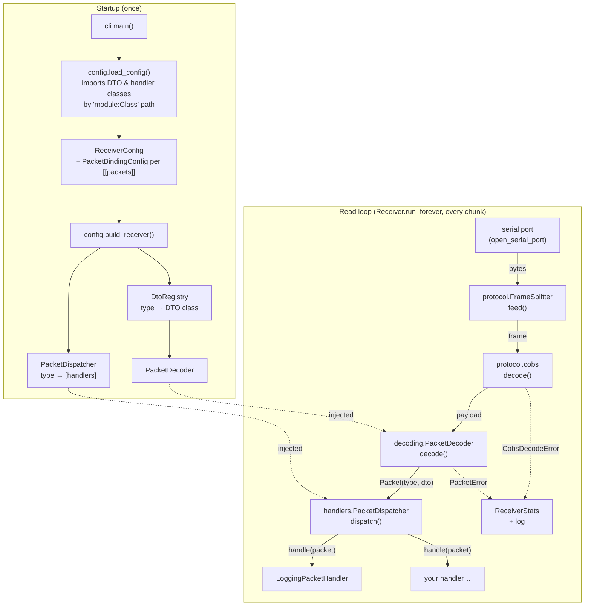

# serial-receiver

Reads a binary stream from a serial port, splits it into frames on `0x00`,
COBS-decodes them, verifies the CRC-16, deserializes each payload into the **DTO**
configured for its packet type, and passes it to the configured **handlers**
(by default: log it to the console).

It works with any sender that speaks the protocol and isn't tied to any particular
hardware. The protocol itself (packet format, CRC, COBS, byte-level example, sequence
diagrams) is documented in the [root README](../README.md#protocol).

**Contents:**
[Run](#run) ·
[Architecture](#architecture) ·
[Configuration](#configuration-which-dto-which-handlers) ·
[Adding a packet type](#adding-a-packet-type) ·
[Writing a handler](#writing-a-handler) ·
[Device discovery](#device-discovery) ·
[Logs and statistics](#logs-and-statistics) ·
[Layout](#layout) ·
[Tests](#tests)

## Run

```bash
uv run serial-receiver                       # uses ./receiver.toml; no port set -> finds the one carrying decodable packets
uv run serial-receiver -c other.toml         # a different config
uv run serial-receiver -p /dev/ttyUSB0 -b 921600 --stats-interval 0   # CLI overrides the config
uv run serial-receiver --discover            # which serial ports carry decodable packets
uv run serial-receiver --log-level DEBUG     # also shows the garbage discarded while syncing
```

| Option | Default | Meaning |
|---|---|---|
| `-c, --config` | `./receiver.toml` | Config file: serial settings and packet type → DTO/handlers bindings. |
| `-p, --port` | `[serial] port`, else discovery | Serial port to read. |
| `-b, --baud` | `[serial] baud` (921600) | Must match the sender. |
| `--stats-interval` | `[stats] interval_s` (5) | Seconds between `Stats:` lines; `0` = off. |
| `--log-level` | `INFO` | `DEBUG` also shows frames discarded while syncing. |
| `--discover` | | Probe every port, print a report, exit. |
| `--probe-seconds` | 3 | Listening time per port, for `--discover` and for port auto-detection. `0` = `--discover` only lists ports. |

A setting given on the command line wins over `receiver.toml`, which wins over the built-in default.

## Architecture

The code is split into packages by topic, with one class per file. The first
docstring of [`serial_receiver/__init__.py`](src/serial_receiver/__init__.py)
gives the same overview.



### Who calls whom

1. **Startup.** `cli.main()` parses the arguments and calls `load_config()`. The loader
   reads `receiver.toml`. For each `[[packets]]` block it imports the DTO class and the
   handler classes from their `"package.module:Class"` paths, validates them, and
   instantiates the handlers with their `options`. The result is a frozen `ReceiverConfig`.
   `build_receiver()` then splits each binding in two:
   - type → DTO class goes into a `DtoRegistry`, wrapped by a `PacketDecoder`;
   - type → handlers goes into a `PacketDispatcher`.

   Both are **injected** into the `Receiver`, which therefore knows no packet type itself.
2. **Port.** `--port`, else `[serial] port`, else discovery: `find_protocol_device()`
   probes every port with the same decoder and takes the only one that decodes.
3. **Read loop.** `Receiver.run_forever()` opens the port and calls `_read_loop()`. The
   loop reads whatever bytes are available, and `FrameSplitter.feed()` turns them into
   complete frames (it keeps partial frames between reads). For each frame,
   `_handle_frame()` runs `cobs.decode()` and then `PacketDecoder.decode()`. The decoder
   checks the CRC, looks up the type byte in the registry, checks the size and calls
   `Dto.from_bytes()`. The result is a `Packet(packet_type, dto)`.
4. **Callbacks.** `PacketDispatcher.dispatch(packet)` calls `handle(packet)` on every
   handler bound to that type, **synchronously, on the read thread**, in config order.
   A handler that raises is logged and skipped. It never stops the stream or the
   other handlers.
5. **Failures.** Any step can reject a frame: `CobsDecodeError`, or a `PacketError`
   subclass (CRC mismatch, unknown type, wrong length). `_on_discard()` counts it in
   `ReceiverStats` and logs it. Before the first valid packet, rejected frames are
   expected noise: they're logged at DEBUG and counted separately (see [sync](#logs-and-statistics)).
6. **Errors on the port** (device unplugged or reset): `SerialException` is caught by
   `run_forever()`, which waits 2 s and reopens the port. The new connection starts
   unsynced again.

### Threads

The receiver is **single-threaded**: reading, decoding and all handlers run on the
main thread. Only discovery uses threads: `_probe_all()` runs one daemon thread per
port, with a shared deadline, so a port that hangs can't block it. A slow handler
(network, disk) delays reading. If you need one, hand the work off to a queue or a
thread inside the handler.

### Extension points

| To change… | Touch | No changes needed in |
|---|---|---|
| what a packet type is decoded into | a DTO in `dto/` + `receiver.toml` | decoder, receiver |
| what happens to decoded packets | a `PacketHandler` + `receiver.toml` | everything else |
| which packet types are accepted | `[[packets]]` blocks in `receiver.toml` | code |
| the wire format (COBS, CRC) | `protocol/` (and the sender) | DTOs, handlers |

## Configuration: which DTO, which handlers

`receiver.toml` binds each packet type byte to a DTO (what the payload is deserialized
into) and to a list of handlers (what happens to it). Classes are referenced as
`"package.module:Class"` and imported at startup, so they can also live outside this package:

```toml
[serial]
# port = "/dev/ttyUSB0"      # omit to use the only port carrying decodable packets
baud = 921600                # must match the sender's baud rate

[stats]
interval_s = 5.0             # 0 disables the periodic stats line

[[packets]]
type = 0x01                  # the packet's first byte, as sent by the sender
dto = "serial_receiver.dto.imu_dto:ImuDto"
handlers = [
    "serial_receiver.handlers.logging_packet_handler:LoggingPacketHandler",
    { class = "serial_receiver.handlers.logging_packet_handler:LoggingPacketHandler", options = { level = "DEBUG" } },
]
```

- `handlers` entries are either a class path, or `{ class = ..., options = {...} }`.
  `options` are passed to the constructor as keyword arguments.
- `handlers = []` still decodes and validates the packet (it counts in the stats), but does nothing with it.
- The same DTO can be bound to several types, e.g. two identical sensors.
- Everything is validated **at startup**, with the block number in the message: wrong
  path, a class that isn't a `PacketDto`/`PacketHandler`, a DTO whose `LAYOUT`
  disagrees with its fields, bad handler options, a duplicate type, a type outside `0x00`–`0xFF`.

The same wiring can be done in code, without a config file:

```python
registry = DtoRegistry()
registry.register(0x01, ImuDto)
dispatcher = PacketDispatcher()
dispatcher.register(0x01, LoggingPacketHandler())
Receiver("/dev/ttyUSB0", 921600, PacketDecoder(registry), dispatcher).run_forever()
```

## Adding a packet type

The sender side, and complete examples (environment sensor, button events, commands),
are in the root README's [Extending to other examples](../README.md#extending-to-other-examples).
On the receiver side:

1. **DTO**: a new file in `dto/` with one dataclass extending `PacketDto`. Its `LAYOUT`
   is the `struct` format of the fields between the type byte and the CRC, in the
   same order as the dataclass fields:

   ```python
   @dataclass(frozen=True, slots=True)
   class EnvDto(PacketDto):
       LAYOUT: ClassVar[struct.Struct] = struct.Struct("<Iff")

       timestamp_ms: int    # I  uint32
       temperature: float   # f  float32
       humidity: float      # f  float32

       def __str__(self) -> str:   # what LoggingPacketHandler prints
           return f"ENV t={self.timestamp_ms}ms {self.temperature:.1f}°C {self.humidity:.0f}%RH"
   ```

   Common format characters: `B`/`b` u8/i8, `H`/`h` u16/i16, `I`/`i` u32/i32, `f` float32, `d` float64.
   Always start with `<` (little-endian, no padding), to match a packed struct.

2. **Config**: a `[[packets]]` block with the new `type`, the `dto` path and its `handlers`.

Until step 2 is done, packets of that type are rejected as `unknown_type`. They appear
in the stats, and in `--discover` as `(no DTO configured)`, so you can tell the sender
already sends them.

## Writing a handler

A handler is a callback that receives every decoded packet of the types it's bound to:

```python
# my_project/csv_handler.py
import csv
import dataclasses

from serial_receiver.decoding.packet import Packet
from serial_receiver.handlers.packet_handler import PacketHandler


class CsvPacketHandler(PacketHandler):
    def __init__(self, path: str) -> None:            # options from receiver.toml arrive here
        self._file = open(path, "a", newline="")
        self._writer = csv.writer(self._file)

    def handle(self, packet: Packet) -> None:         # called once per packet, on the read thread
        self._writer.writerow([packet.packet_type, *dataclasses.astuple(packet.dto)])
        self._file.flush()
```

```toml
handlers = [
    "serial_receiver.handlers.logging_packet_handler:LoggingPacketHandler",
    { class = "my_project.csv_handler:CsvPacketHandler", options = { path = "imu.csv" } },
]
```

Rules (see the [`PacketHandler`](src/serial_receiver/handlers/packet_handler.py) docstring):

- Keep `handle()` quick. It runs inside the read loop.
- An exception is logged and skipped. It doesn't stop the receiver.
- One instance serves every type it's bound to. Check `packet.packet_type` if it matters.
- `packet.dto` is frozen. Treat it as read-only.

## Device discovery

Discovery doesn't look at what kind of device is on a port. A device counts as
found only if packets coming from it **actually decode** with the current
configuration (baud rate + DTOs).

`--discover` opens **every** serial port at the configured baud rate, listens to all
of them in parallel for `--probe-seconds` (default 3), and reports what it heard. Ports
with decodable traffic are marked `*` and listed first (example output):

```
4 serial port(s), 1 speaking the protocol:

* /dev/cu.usbserial-14430              10C4:EA60  CP2102N USB to UART Bridge Controller
      manufacturer: Silicon Labs   serial: 564c05eadf44ed11bbdad3c90a86e0b4
      probe @ 921600 baud, 3s: STREAMING ~99.0 pkt/s | 0x01 ImuDto x297 | rejected: 0
  /dev/cu.BLTH                         -          n/a
      probe @ 921600 baud, 3s: no valid packets (rejected frames: 0)

* = decodable packets received
```

- Probing (`DeviceProber`) runs the same steps as the read loop (split, COBS, decode)
  but only counts the results. Nothing is dispatched to handlers.
- USB ID, manufacturer and serial number are whatever the OS reports. They're shown
  for information only, and nothing is decided based on them.
- CRC-valid packets whose type has no DTO configured still count, shown as
  `(no DTO configured)`: the sender speaks the protocol, but the config doesn't know that type yet.
- Each probe runs in its own thread with a timeout. A port that blocks on open/read
  is reported as `ERROR - no response` instead of stalling the others.
- A port held by another process shows `ERROR - ... busy`.
- A device sending at a different baud rate isn't found: probing only listens at the configured one.
- Some devices reset when their port is opened, so the start of a probe may be their boot time.
- `--probe-seconds 0` only lists the ports, without opening any.

When no port is configured (neither `-p` nor `[serial] port`), the receiver runs the
same probe first and uses **the only port carrying decodable packets**. With none or
several, it stops and says so. That probe opens the port once more, so a device that
resets on open resets twice.

## Logs and statistics

```
15:40:44.490 INFO    serial_receiver.config.receiver_factory: Packet type 0x01 -> ImuDto, handlers: LoggingPacketHandler
15:40:44.505 INFO    serial_receiver.receiver.receiver: Listening on /dev/cu.usbserial-14430 @ 921600 baud
15:40:44.608 INFO    serial_receiver.receiver.receiver: In sync: first valid packet received
15:40:44.608 INFO    serial_receiver.handlers.logging_packet_handler: IMU t=94ms ax=+0.146 ay=+0.478 az=+9.810 m/s^2
15:40:49.507 INFO    serial_receiver.receiver.receiver: Stats: 98.0 pkt/s | ok=490 errors=0 (0.00%: ...) overflows=0
```

**Sync phase.** Until the first valid packet, rejected frames are expected rather than
link errors. The receiver may have joined mid-frame, and some devices reset when their
port opens and print a boot log at another baud rate. These frames are logged at DEBUG
and counted as `discarded_while_syncing`, outside the error stats. From the first valid
packet (`In sync`) on, every rejected frame is a WARNING and counts as an error.

**`Stats:` line** (every `interval_s`). Counters are cumulative over the run.

| Field | Meaning |
|---|---|
| `pkt/s` | Valid packets per second over the last interval. |
| `ok` | Packets decoded and dispatched. |
| `errors` (`%`) | Rejected frames after sync, and their share of all frames. |
| `cobs` | Frame wasn't valid COBS. |
| `crc` | Valid COBS but CRC mismatch, i.e. corrupted on the wire. A rising rate means the link is unreliable (baud rate too high, bad cable or hub). |
| `unknown_type` | Valid CRC, but no DTO configured for the type. |
| `other` | Valid CRC, but the size doesn't match the DTO: the sender and the DTO disagree on the layout. |
| `overflows` | Runs of more than 256 bytes without a delimiter (noise, wrong baud). Counted per connection. |

On Ctrl+C the receiver logs the final `ReceiverStats`.

The receiver reconnects by itself if the port goes away (device unplugged or
reflashed). A port can be held by only one process at a time, so stop the receiver
before anything else needs it (e.g. flashing).

## Layout

One class per file, grouped by topic:

```
receiver.toml                 default config
src/serial_receiver/
  __init__.py                 package overview: wiring + read-loop pipeline
  cli.py                      entry point: arguments, logging, config + overrides, port resolution
  protocol/                   raw bytes -> frames -> payloads (no knowledge of packet meaning)
    frame_splitter.py           FrameSplitter: stream -> frames on 0x00 (state machine: unsynced/collecting/overflowing)
    cobs.py                     COBS encode/decode, with validation
    cobs_decode_error.py        CobsDecodeError
    crc.py                      CRC-16/CCITT-FALSE
  dto/                        data structures payloads are deserialized into
    packet_dto.py               PacketDto: base class (LAYOUT <-> dataclass fields, startup validation)
    imu_dto.py                  ImuDto
  decoding/                   payload <-> Packet
    packet.py                   Packet: packet type + DTO
    dto_registry.py             DtoRegistry: packet type -> DTO class
    packet_decoder.py           PacketDecoder: size, CRC, type lookup, length, from_bytes (in that order)
    errors/                     PacketError and its subclasses: CrcMismatch, UnknownPacketType, PacketLength
  handlers/                   what happens to decoded packets
    packet_handler.py           PacketHandler: the callback interface
    logging_packet_handler.py   LoggingPacketHandler
    packet_dispatcher.py        PacketDispatcher: packet type -> handlers, error isolation
  receiver/                   serial port side
    receiver.py                 Receiver: read loop, sync phase, stats, reconnect
    receiver_stats.py           ReceiverStats
    serial_port.py              open_serial_port(): shared by Receiver and DeviceProber
  discovery/                  finding ports that carry decodable packets
    port_discovery.py           list_devices(), discover() (parallel probing), find_protocol_device()
    device_prober.py            DeviceProber: listens to one port, classifies frames
    probe_result.py             ProbeResult
    discovered_device.py        DiscoveredDevice: OS port info + probe result
    discovery_report.py         format_report(): the --discover output
    port_discovery_error.py     PortDiscoveryError
  config/                     receiver.toml -> wired Receiver
    config_loader.py            load_config(): parsing, validation, dynamic class import
    receiver_config.py          ReceiverConfig
    packet_binding_config.py    PacketBindingConfig: type + DTO class + handler instances
    receiver_factory.py         build_decoder() / build_receiver()
    config_error.py             ConfigError
tests/                        same layout as src/
```

## Tests

```bash
uv run pytest
```

The tests follow the layout of `src/` and need no hardware: the serial port and
`comports()` are replaced with fakes. They cover the CRC check value, COBS round
trips and malformed frames, frame splitting across arbitrary chunk boundaries, the IMU
wire layout, every decoder rejection path, DTO definition checks, dispatcher error
isolation, config validation (including the shipped `receiver.toml`), and discovery
(classification, parallel probing, blocked ports, the report).

## License

[MIT](../LICENSE) © Marco Picone ([picone.m@gmail.com](mailto:picone.m@gmail.com)), like the rest of the repository.
